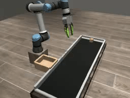
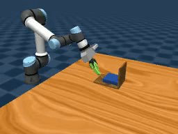

# Simulation

Each task folder has the same layout:

| File | Purpose |
| --- | --- |
| `env.py` | Scene, controller and success check |
| `timing.py` | Sensor delivery, inference delay and action-plan updates |
| `evaluate.py` | Closed-loop evaluation under one timing condition |
| `replay.py` | Replay a recorded demonstration (Conveyor and Pivoting) |
| `assets/` | Models used by the scene (Conveyor and Pivoting) |

[`conveyor/`](conveyor/) and [`pivoting/`](pivoting/) are our MuJoCo tasks.
[`dexmimicgen/`](dexmimicgen/) runs the six DexMimicGen tasks (Threading,
Assembly, Transport, Coffee, Drawer Cleanup, Pouring) on the official
DexMimicGen and Robosuite environments. [`policy.py`](policy.py) runs a
checkpoint inside these loops, and [`export.py`](export.py) turns a dataset
into training windows for [`scripts/train.py`](../scripts/train.py).

| Conveyor | Pivoting |
| :---: | :---: |
|  |  |

Raw MuJoCo rollouts: [Conveyor video](assets/conveyor.mp4) · [Pivoting video](assets/pivoting.mp4).

## Setup

From the repository root:

```bash
pip install -e ".[simulation]"
python scripts/download.py data --task pivoting
python scripts/download.py checkpoints --task pivoting --method all
```

For the DexMimicGen tasks, see the [reproduction guide](../docs/reproduction.md#setup).
On a headless machine set `MUJOCO_GL=egl`.

## Replay data

```bash
python -m simulation.pivoting.replay --data data/pivoting/episode_data.zarr --episode 0 --video replay.mp4
python -m simulation.conveyor.replay --data data/conveyor/episode_data.zarr --episode 0 --video replay.mp4
```

Pivoting restores each recorded state by default, which reproduces the dataset
frames; add `--actions` to re-simulate from the recorded commands. Conveyor
re-simulates its recorded 20 Hz commands.

## Evaluate

```bash
python -m simulation.pivoting.evaluate --checkpoint checkpoints/pivoting/chronos/seed0.ckpt \
  --condition nominal --output results/pivoting-nominal.json
python -m simulation.dexmimicgen.evaluate --task coffee --data data/coffee \
  --checkpoint checkpoints/coffee/chronos/seed0.ckpt --condition nominal --output results/coffee-nominal.json
```

The defaults are the paper's first evaluation batch. To run every paper job and
build the results table, use [`scripts/evaluate_paper.py`](../docs/reproduction.md#evaluate).

| Condition | Sensor schedule | Observation delay | Inference delay |
| --- | --- | --- | --- |
| `nominal` | Nominal | 0 | 0 |
| `sensor_id` | Moderate frequency changes | 0–50 ms | 0 |
| `sensor_ood` | Broad frequency changes | 0–100 ms | 0 |
| `inference_0_100ms` | Nominal | 0 | 0–100 ms |
| `inference_0_200ms` | Nominal | 0 | 0–200 ms |
| `combined_sensor_ood_inference_0_200ms` | Broad frequency changes | 0–100 ms | 0–200 ms |

Conveyor and DexMimicGen sense at 20 Hz nominally, 12.5–33.3 Hz for `sensor_id`
and 1–50 Hz for `sensor_ood`. Pivoting's camera, pose and force rates are
20/20/100 Hz nominally, 15–20/15–20/75–100 Hz for `sensor_id` (without delay),
and 1–30/1–50/10–100 Hz for `sensor_ood`. Actions are 20 Hz targets. Chronos
Policy receives the observation and action timestamps; DT does not.

## Train

```bash
python -m simulation.export --task pivoting --data data/pivoting --output data/pivoting-windows
CUDA_VISIBLE_DEVICES=0 python scripts/train.py --data data/pivoting-windows \
  --config data/pivoting-windows/config.json --method chronos --output outputs/pivoting/chronos
python -m simulation.pivoting.evaluate --checkpoint outputs/pivoting/chronos/best.pt \
  --condition sensor_ood --output results/pivoting-retrained.json
```

`export.py` supports all eight tasks and, by default, resamples each training
window's sensor and inference timing.
